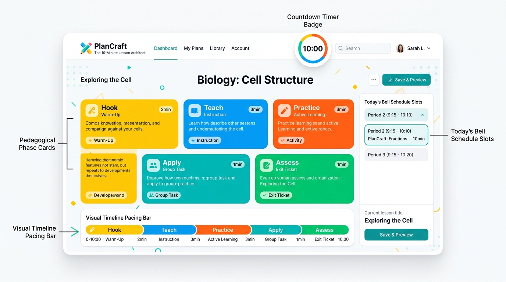

# PlanCraft 2.0 — Production-Quality Lesson Architect

> **Polished, responsive, offline-first lesson planning assistant for educators.** Enter your topic, select your grade level and class duration, and generate an exact, mathematically timed pedagogical plan with real-time bell reminders, pedagogical quality analysis, formative assessment generators, and an interactive fullscreen classroom timer.



---

## ⚡ What's New in PlanCraft 2.0

PlanCraft 2.0 represents a production-grade upgrade that transforms the original lightweight planner into a comprehensive, resilient, offline-first teaching assistant while preserving its **zero-runtime-dependency** design and vanilla HTML/CSS/JavaScript architecture:

1. **Mathematical Duration Invariants (1–480 min)**: Strict finite positive integer validation with Hare-Niemeyer integer distribution. Dedicated models for ultra-short micro-lessons (1m sprint, 2m kickoff, 3m triple-step) and extended block sessions up to 8 hours.
2. **Absolute-Deadline Presenter Timer**: Eliminates background tab throttling drift using real wall-clock timestamps (`targetEndTimeMs`), tab visibility-change resynchronization, duplicate interval prevention, phase reset, and Fullscreen presentation mode (`F` key).
3. **Lesson-Quality Alignment Rubric**: Evaluates instructional balance, student active autonomy ratio, formative check density, and flags pacing risks (such as lectures exceeding 20 minutes).
4. **Editable Objectives & Success Criteria**: Aligned SWBAT (*Students Will Be Able To...*) learning targets and measurable *"I Can"* success criteria with live inline editing and persistent auto-save.
5. **3-Tier Quiz & Exit Ticket Generator**: Automated educational assessment drafts with Beginner (Recall), Intermediate (Apply), and Advanced (Transfer) questions and sample answer keys.
6. **Dual Print & PDF Export Modes**:
   - 👩‍🏫 **Teacher Master Dossier**: Pacing breakdown, bell intervals, teacher think-alouds, formative checks, and personal notes.
   - 🧑‍🎓 **Student Guided Worksheet**: Clean printable student sheet with Name/Date header, Learning Targets, "I Can" checklist, guided notes box, and 3-Tier Exit Ticket.
7. **Enhanced Stash Library**: Live keyword search, grade level filtering, plan duplication, inline renaming, single JSON import/export, and versioned JSON backup/restore with schema validation.
8. **Multi-Day Unit Workspace**: Sequence individual lessons into multi-day curricular arcs with overarching essential questions and cumulative instructional minutes.
9. **Teaching Progress Analytics**: 100% local session logger tracking completed teaching periods, classroom minutes delivered, and phase completion rates.
10. **Optional AI Provider Interface**: Server-side proxy architecture keeping secret credentials off client devices, accompanied by schema validation, network timeout safeguards, offline fallback, and clear *"AI Draft"* teacher labeling.
11. **Automated Test Suite**: 41 comprehensive automated tests using Node's native test runner (`node:test`) covering mathematical allocations, boundaries, migrations, escaping, and rubrics.

---

## 🎯 Pedagogical Architecture

PlanCraft is engineered around research-backed pedagogical frameworks:

```text
┌────────────────────────────────────────────────────────────────────────┐
│                        Lesson Arc Structure                            │
├──────────────┬──────────────────┬─────────────────┬────────────────────┤
│ 1. The Hook  │ 2. Direct Model  │ 3. Active Collab│ 4. Independent App │
│ (Schema/Goal)│ ("I Do" Think)   │ ("We Do" Guide) │ ("You Do" Mastery) │
├──────────────┴──────────────────┴─────────────────┴────────────────────┤
│               5. Formative Closure & Exit Ticket Slip                  │
└────────────────────────────────────────────────────────────────────────┘
```

- **Elementary (K-5)**: Kinesthetic, visual storytelling, manipulative scaffolding, and high warmth.
- **Middle School (6-8)**: Gamified collaboration, structured peer discourse (think-pair-share), and tiered challenge levels.
- **High School (9-12)**: Standards-aligned analytical inquiry, real-world relevance, and evidence citation.
- **College / University**: Socratic seminar protocols, theoretical evaluation, and self-directed synthesis.
- **Adult & Professional**: Applied, outcome-oriented workplace case scenarios and immediate practical takeaways.

---

## 🛡️ Reliability & Security Guarantees

- **100% Offline-First**: All application logic, scheduling, synthesis, and storage execute client-side. Works completely without an internet connection.
- **Data Persistence & Migration (Schema v3)**: Automatic data migration for legacy records (`v1`/`v2` to `v3`). Protects custom teacher notes, completed phase checkboxes, prep checklists, and timer states across browser reloads.
- **Storage Quota Guard**: Gracefully intercepts `QuotaExceededError` and provides backup reminders without crashing.
- **Universal HTML Escaping**: Strictly sanitizes all user-entered topics, notes, URL parameters, and imported JSON structures to eliminate dynamic HTML injection vulnerabilities.
- **Educational Privacy Principle**: Zero telemetry, zero third-party trackers, zero user logins, and zero student PII collection.

---

## 💻 Tech Stack & Zero-Dependency Design

| Layer | Implementation | Details |
| :--- | :--- | :--- |
| **Markup** | HTML5 Semantic Architecture | Accessible ARIA landmarks, dialog roles, and live regions |
| **Styling** | Vanilla CSS3 | Custom design system tokens, Neo-Bento cards, print stylesheets, reduced motion |
| **Logic** | Vanilla Modern JavaScript | ES6+ modular architecture, zero runtime dependencies |
| **Audio** | Web Audio API | Synthesized micro-tones and chimes (zero external audio files) |
| **Testing** | Node.js Test Runner | Built-in `node:test` and `node:assert/strict` (zero test dependencies) |
| **Build & Dev** | Vite 6 | Development preview server and optimized production bundler |

---

## 🚀 Getting Started

### Option A: Direct Static Launch (Zero Install)
Because PlanCraft has zero runtime dependencies, you can open `index.html` directly in any modern browser:
```bash
# Python 3
python -m http.server 3000

# or PHP
php -S localhost:3000
```

### Option B: Using Vite Development Server
```bash
# 1. Install dev tools
npm install

# 2. Start local development server
npm run dev
```
Open [http://localhost:3000](http://localhost:3000) in your browser.

---

## 🧪 Running Automated Tests

PlanCraft 2.0 includes an automated test suite executed with Node's native test runner:

```bash
npm test
```

### Test Coverage Highlights:
- **Duration Validation**: Empty, zero, negative, fractional, excessive (>480m), NaN, and non-finite inputs.
- **Time Allocation Invariants**: Mathematical Hare-Niemeyer exact sum checks across 1m, 2m, 3m, 5m, 10m, 30m, 45m, 60m, 90m, 120m, 240m, and 480m durations.
- **Bell Schedule Engine**: Sequential clock intervals and hour boundary transitions.
- **Dynamic Rebalancing**: Invariant preservation during in-plan $+1$m / $-1$m duration shifts.
- **Quality Rubric Calculations**: Autonomy ratios, formative coverage, and pacing alerts.
- **3-Tier Assessment Generator**: Question generation and sample answer criteria.
- **Schema Migrations**: Seamless upgrade of legacy plans to Schema v3.
- **Security & HTML Escaping**: Sanitization of script tags, quotes, ampersands, and angle brackets.

---

## 📦 Production Build

To create the production distribution bundle:
```bash
npm run build
```
Output artifacts are generated in `dist/` with optimized HTML, CSS, and JavaScript.

---

## 📂 Project Structure

```text
plancraft/
├── index.html              # Main semantic UI and accessible modal dialogs
├── style.css               # Neo-Bento design system, themes, print & accessibility rules
├── script.js               # PlanCraft 2.0 core engine, absolute timer, persistence & APIs
├── vite.config.js          # Vite development and bundle configuration
├── package.json            # Scripts and metadata
├── tests/
│   └── plancraft.test.js   # Automated test suite (41 test cases)
├── screenshots/
│   └── preview.png         # Interface preview
└── README.md               # Documentation
```

---

## ⌨️ Keyboard Shortcuts

| Shortcut | Context | Action |
| :--- | :--- | :--- |
| `⌘ + Enter` / `Ctrl + Enter` | Anywhere | Generate lesson plan from current inputs |
| `Space` | Classroom Timer Modal | Pause / Resume countdown timer |
| `F` | Classroom Timer Modal | Toggle Fullscreen Classroom Presentation |
| `N` | Classroom Timer Modal | Advance to Next Phase |
| `P` | Classroom Timer Modal | Return to Previous Phase |
| `Escape` | Any Modal | Close active modal dialog |

---

## 📄 License

This project is licensed under the [MIT License](LICENSE).